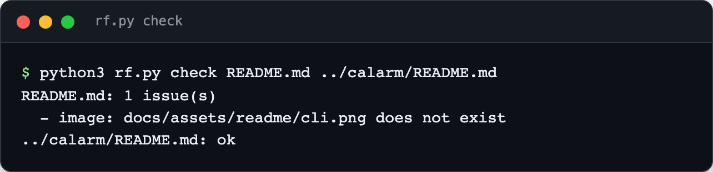

<div align="center">

<h1>readme-forge</h1>

<p><b>Front pages for GitHub repos.</b></p>

<p><i>Most READMEs are notes to self. A visitor gives a repo ten seconds; the page should use them.</i></p>

<h6>


</h6>

<a href="#whats-inside"><b>What's inside</b></a> ·
<a href="#use-it"><b>Use it</b></a> ·
<a href="#with-an-agent"><b>With an agent</b></a>

<br><br>



</div>

<br>

## Why

A good front page has a shape: a centred hero with a one-line pitch, a real screenshot, the
problem in a few sentences, how it works in three steps, the features, and the shortest path
to running it. That shape is easy to describe and tedious to produce for every repo, mostly
because of the screenshots and the checking. This kit is the style guide, the skeletons and the
tools, with an agent skill so the writing can be delegated.

The reference page is [calarm](https://github.com/parthchandak02/calarm).

## What's inside

| | |
|---|---|
| [`STYLE.md`](STYLE.md) | The spec: page shape, hero rules, voice, images, privacy, sidebar |
| [`layouts/`](layouts) | Skeletons for an `app`, a `cli`, a `visual` web piece and a `library` |
| [`rf.py`](rf.py) | Screenshots, terminal images, README linting, GitHub sidebar, folder audit |
| [`skill/SKILL.md`](skill/SKILL.md) | Step-by-step instructions for Claude Code, Hermes or any agent |

## Use it

```bash
pip install playwright && playwright install chromium     # only for shoot/term

python3 rf.py shoot https://example.com -o docs/assets/readme/hero.jpg --wait 4000
python3 rf.py shoot ./dist -o docs/assets/readme/hero.jpg       # serves the folder itself
python3 rf.py shoot http://localhost:5173 -o hero.png --size 390x844 --mobile
python3 rf.py shoot ./dist -o hero.jpg --seed 1 --mock "**/api/data*=demo.json"   # repeatable frame, demo data
python3 rf.py shoot URL -o hero.jpg --wheel 400 --drag 600,400,760,380             # zoom out, orbit a 3D scene
python3 rf.py shoot URL -o hero.jpg --type "#search=Lisbon" --click 640,300        # type, then click
python3 rf.py shoot URL -o hero.jpg --init-js "localStorage.demo='1'" --stable 6000 --dark   # seeded state, settled frame
python3 rf.py term "mytool --help" -o docs/assets/readme/cli.png
python3 rf.py check README.md                                   # lint before pushing
python3 rf.py sidebar owner/repo --description "..." --homepage https://... --topics a,b,c
python3 rf.py audit ~/projects                                  # README status of every repo
```

`check` looks for a centred hero, anchors that resolve, images that exist and stay under
600 KB, alt text on every image, and leaks: personal email addresses, phone numbers, local
`/Users/...` paths and API keys.

`term` runs a command with colour forced on and renders the output as a terminal window. Pass
`--text file` to render saved output instead, for commands that need credentials. Long output is cut
at `--max-lines` (default 28), with a note.

Tests: `python3 -m unittest discover tests`.

## With an agent

Point the agent at [`skill/SKILL.md`](skill/SKILL.md), or install it:

```bash
ln -s "$PWD/skill" ~/.claude/skills/readme-forge
```

Then: *"Use readme-forge to redo the README for this repo."* The skill has the agent read the
code before writing, capture and inspect its own screenshots, run `check`, set the sidebar,
and commit only the README and its images.

<br>

<div align="center">
<sub>MIT licensed.</sub>
</div>
